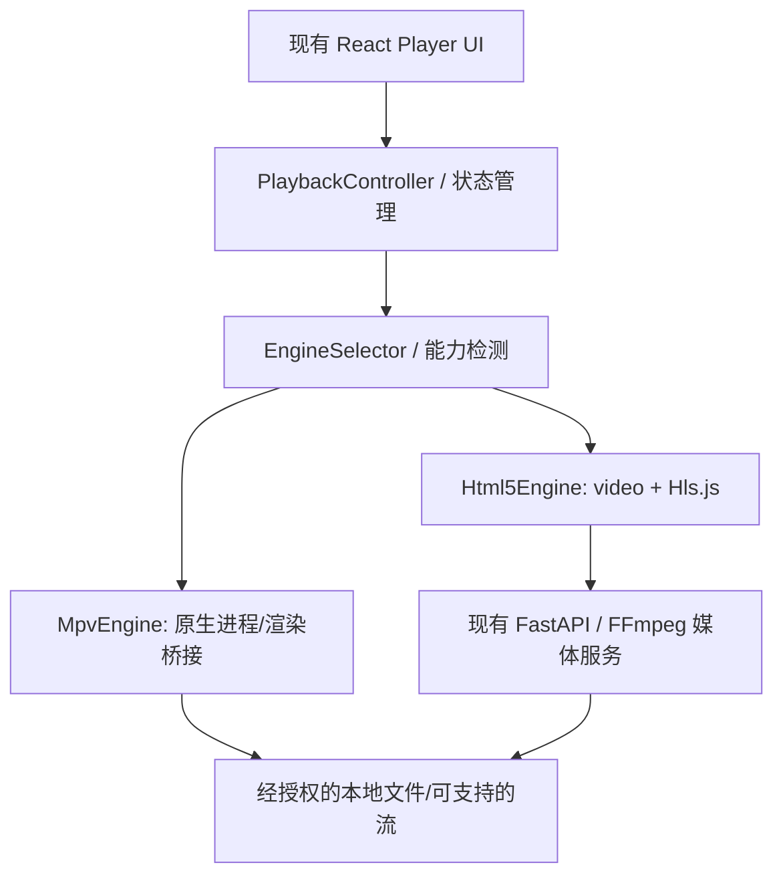

# AVHub 播放架构改造实施规范（交付 Codex）

> 版本：v1.0 · 2026-10-24  
> 目标仓库：`https://github.com/jhlxlml/avhub`  
> 适用范围：Windows Electron + React + FastAPI/FFmpeg 播放链路  
> 状态：**待在目标仓库中核验并实施；本文件不是已完成的代码变更**

## 0. 给 Codex 的直接执行指令

你是 AVHub 的高级桌面播放器架构工程师。请在用户当前 AVHub 仓库中，依据本规范**分阶段实现**“统一播放接口 + 原生 MPV 播放能力 + HTML5/Hls.js 回退 + 现有媒体服务保留”的渐进式架构升级。

**本轮明确不实现 Cinema OS、不进行 UI 重新设计、不替换现有 React 页面布局**。只允许为播放引擎接入和诊断而增加必要的最低限度设置与状态提示。若仓库实际现状与本文的历史信息不符，以**当前源码与现有测试**为准，先记录差异，再调整实施细节，不得直接覆盖已有能力。

工作准则：

1. 先查看 `AGENTS.md`、`git status`、项目 README、构建脚本、Electron 主进程/预加载脚本、`Player.tsx`、媒体服务和相关测试。**保留用户所有未提交修改**；避免全盘格式化。
2. 先建立真实的“现状清单+测试基线”，确认 MPV 当前是未接入、外部可选还是已部分嵌入。2026-10-05 的讨论曾显示 MPV 尚未接入；2026-10-24 的讨论提到可选 MPV；**不得把任何历史记录当作源码事实**。
3. 分小步实现，每阶段运行可用的 lint、类型检查、单测和相关集成测试。阶段未通过时修复，不得带着关键失败推进到下一阶段。
4. 保持现有 HTML5/Hls.js、FastAPI、FFmpeg、TS 索引、indexed-remux、字幕、播放进度、队列与历史记录正常工作。默认值先保持旧播放路径；新路径通过 feature flag 开启，达标后才能调整默认。
5. 需要增加原生依赖、下载 DLL、修改打包配置或调整许可证时，先列出来源、版本、哈希、许可证、平台支持与安全影响；不要擅自引入来历不明的二进制。
6. 若遇到需要用户批准的破坏性操作、受保护工作流或无法安全解决的本机/Windows 原生依赖问题，明确停在该阶段并附复现步骤。不要“假实现” MPV 嵌入、用模拟画面宣称通过。
7. 每完成一个阶段，输出：变更摘要、文件清单、运行命令、测试结果、已知限制、回滚方式、下一阶段建议。**不得自动推送到远端**。

## 1. 目标与非目标

### 本轮目标

- 把播放能力从大体积 React 播放组件中解耦，形成可替换的 `PlaybackEngine` 抽象。
- 在 Windows 验证并接入 MPV/libmpv 原生播放能力，优先服务不适合 Chromium 直接播放的本地文件。
- 保留 HTML5 Video / Hls.js / MSE 作为完整可用的回退引擎。
- 尽量让可直接由 MPV 解码的本地媒体绕过不必要的 FastAPI→FFmpeg 分片→HLS 路径，同时保留媒体库 ID、进度、权限及字幕等业务逻辑。
- 提升 seek、首帧、连续播放、异常恢复与可观测性；提供可重复的性能基准。
- 提供 Windows 开发态和打包态的一致行为、原生组件的可验证来源与许可证说明。

### 明确不做

- **不集成、不开发 Cinema OS**；不改版媒体库、导航栏、主题、动画、设置布局。Cinema OS 只记录在末尾未来路线图。
- 不重写整个 FastAPI 后端，不废弃原有 direct/indexed-ts/indexed-remux/transcode 路径。
- 不要求所有文件默认走 MPV；不删除 Web 播放引擎。
- 不实施自动生成字幕、AI 搜索、海报识别、云同步或 Jellyfin 新功能；现有能力只需保持兼容。
- 不以不可靠的子窗口覆盖/透明悬浮窗方案伪装成真正无瑕疵的嵌入。
- 不在未验证的情况下承诺所有内容的 HDR、Dolby Vision、8K 或零拷贝支持。

## 2. 已知现状（Codex 必须重新核实）

来自此前项目讨论的**历史信息**：

| 部分 | 已讨论过的情况 | 核验点 |
| --- | --- | --- |
| 桌面端 | Electron + React；部分页面初始化集中于 `main.tsx` | 核对真实入口、进程划分及打包器 |
| 播放端 | `Player.tsx` 承担较多状态、UI 和控制逻辑 | 找出所有调用者、事件、存储键 |
| 常规媒体 | MP4/WebM 经 HTTP Range 的直连路径 | 确认 URL、Range、响应头和安全约束 |
| TS | 关键帧索引 + 读取原文件范围 + Hls.js/MSE | 确认 seek 是否重启 FFmpeg |
| MKV/MOV/AVI 等 | indexed-remux 按需调用 FFmpeg 生成分片 | 确认分片缓存、串行锁、取消策略 |
| 其他路径 | transcode 回退 | 确认启用条件及硬件软件解码 |
| 字幕 | 外挂字幕、字幕延迟、轨道选择 | 两引擎语义保持一致 |
| MPV | 存在历史记录差异：早期未集成，后来讨论可选 MPV | 必须检查当前是否真有适配器、窗口集成、打包和测试 |
| 业务能力 | 媒体数据库、进度/队列恢复、播放路由 | 保留现有数据结构与存储兼容性 |

此前讨论中的 seek 数字（如 direct ~203 ms、TS ~216 ms、indexed-remux p95 ~558 ms）只可作为**历史参考**，不能当作本轮性能基线。先在同一硬件、同一片源与构建版本上重新测量。

## 3. 目标架构



职责边界：

- **React UI**：呈现按钮、进度条、字幕和用户交互；不直接依赖 Hls.js 或 mpv 命令。
- **PlaybackController**：单实例状态机、播放源变更、生命周期、恢复、切换与竞态控制。
- **EngineSelector**：根据来源、文件能力、用户偏好、原生能力探测、失败历史选择引擎；不可仅通过扩展名判断解码支持。
- **Html5Engine**：复用现有 Hls.js/video/MSE/媒体服务；优先保持回归稳定。
- **MpvEngine**：提供 MPV API、字幕/音轨控制、属性订阅、渲染生命周期与错误分类。
- **NativeHost/Bridge**：仅处于可信的 Electron 主进程或隔离的原生辅助进程，不向渲染端暴露路径任意执行/命令执行能力。
- **FastAPI/FFmpeg**：媒体管理、索引、必要时的 remux/transcode/缓存；对 MPV 可直读本地文件不再强制中转。

注意：MPV 绕过 HTTP 服务仅针对**有权限、同一机器上的本地文件**；对远程 URL、需要鉴权的媒体、网络盘、安全受限场景保留原有服务路径或明确允许的流代理。路径与权限验证不得因此绕过。

## 4. 公共类型与接口（示意，最终命名遵循现有代码规范）

建议新建相对独立模块，例如 `frontend/src/playback/`；实际目录可按仓库结构调整。

```ts
export type EngineKind = 'html5' | 'mpv';
export type EnginePreference = 'auto' | 'html5' | 'mpv';

export type MediaSource = {
  mediaId: string;
  kind: 'local' | 'remote' | 'stream';
  canonicalUri: string;     // UI 使用的源标识，非任意可执行路径
  mimeType?: string;
  container?: string;
  videoCodec?: string;
  audioCodec?: string;
  seekable?: boolean;
  resumePositionSec?: number;
};

export type PlaybackState = {
  status: 'idle' | 'loading' | 'ready' | 'playing' | 'paused' |
    'buffering' | 'ended' | 'error' | 'destroyed';
  engine: EngineKind;
  positionSec: number;
  durationSec: number | null;
  bufferedRanges: ReadonlyArray<[number, number]>;
  volume: number;
  muted: boolean;
  rate: number;
  videoSize?: { width: number; height: number };
  error?: { code: string; message: string; recoverable: boolean };
};

export type Track = {
  id: string;
  type: 'audio' | 'subtitle';
  language?: string;
  title?: string;
  external?: boolean;
  selected: boolean;
};

export interface PlaybackEngine {
  readonly kind: EngineKind;
  init(target: unknown): Promise<void>; // 实际替换为类型安全的 surface/host
  load(source: MediaSource, opts?: { signal?: AbortSignal }): Promise<void>;
  play(): Promise<void>;
  pause(): Promise<void>;
  seekTo(seconds: number, opts?: { exact?: boolean }): Promise<void>;
  setVolume(value: number): Promise<void>;
  setMuted(value: boolean): Promise<void>;
  setRate(value: number): Promise<void>;
  listTracks(type?: Track['type']): Promise<Track[]>;
  selectTrack(type: Track['type'], id: string | null): Promise<void>;
  setSubtitleDelay(seconds: number): Promise<void>;
  getState(): PlaybackState;
  subscribe(listener: (state: PlaybackState) => void): () => void;
  dispose(): Promise<void>;
}
```

接口要求：

- 可多次 `load`，每次具有递增 `sessionId/generation`；旧请求、旧事件不能覆盖新媒体状态。
- `dispose()` 幂等；所有 pending Promise 在取消、退出或切换时有明确完成/拒绝语义。
- 状态事件去重并节流：播放位置约 4–10 Hz 更新 UI；seek 完成、错误、轨道变化即时通知。
- 单位统一：播放位置与字幕延迟为**秒**，内部转换只在各引擎适配层发生。
- 播放源路径不得直接从不可信前端传入任意本地文件；使用现有已授权媒体 ID 解析机制。
- 出错时保留错误代码、源标识、当前引擎、重试次数；日志不得包含凭据或完整敏感 URL。

## 5. 引擎选择与失败回退

初始配置：`playbackEnginePreference = 'auto'|'html5'|'mpv'`，初期默认仍指向既有稳定行为；独立 `nativePlaybackEnabled = false` 功能开关。设置迁移必须保留旧配置。

建议选择原则：

1. 原生功能关闭或运行环境不支持/找不到可信 MPV：HTML5。
2. 用户明确选择 HTML5：HTML5；明确选择 MPV：尝试 MPV，失败显示诊断并提供 HTML5 回退。
3. `auto` 且已验证原生引擎可用：优先让**本地复杂媒体**（如 MKV、HEVC、ASS 复杂字幕，前提是探测可支持）走 MPV；普通 MP4/WebM 沿用现有 direct HTML5 链路，直到测试证明改动有价值。
4. 远程媒体：首先沿用已验证的 URL/鉴权/代理/流协议支持，不因文件后缀强制切换。
5. 自动 fallback 仅限**适配器初始化失败/明确解码不支持/可恢复打开失败**，并设定最多一次跨引擎切换；损坏文件和通用源错误不得无限循环。

切换时保存并恢复：`mediaId`、最近 position、播放/暂停意图、音量、速率、音轨与字幕轨（允许以语言/名称合理映射）、字幕延迟；需要可见地告知用户发生了引擎回退。不要保存明文系统路径到新日志。

## 6. Windows MPV 原生集成决策门槛（先 PoC，后选型）

### PoC A：libmpv Render API（优先评估）

基于 `libmpv` API 在独立原生渲染宿主中控制并输出画面，评估 D3D11/OpenGL 适配、Electron 组合器对接、线程模型、纹理/帧交换成本、颜色空间、全屏和叠层。官方 `render.h` 推荐 render API，且提及其线程约束。**不能假定 Electron 提供现成的 D3D11 视频嵌入表面**。

### PoC B：原生子窗口（备选，不可直接视为正式方案）

评估 HWND 父子窗口/MPV `wid` 等可行性，记录窗口层级、原生 surface 盖住 HTML 控件、焦点、鼠标、DPI、缩放、窗口移动、最大化/恢复、最小化、多显示器/全屏切换、字幕 OSD 等行为。官方说明原生窗口嵌入可能在部分 GUI 工具包下出现问题，故不得只验证“能看到视频”就宣布成功。

### PoC 验收矩阵

| 场景 | 必须核验 |
| --- | --- |
| 普通/全屏/最大化/最小化 | 视频位置与尺寸正确，无黑屏和残留窗口 |
| React 进度条、菜单、字幕弹层 | 所需交互可用，无无法控制的 z-order 遮挡 |
| 鼠标键盘、快捷键、焦点 | 无焦点丢失、按键重复、点击透传错误 |
| Windows 100%/125%/150% 缩放 | 逻辑像素/物理像素坐标正确 |
| 不同刷新率、多显示器、独显/集显 | 无异常黑帧或窗口跳跃；记录不支持组合 |
| 4K HEVC、AV1、HDR 样本 | 检查解码方式、实际色彩/输出、丢帧，而非只判断能播放 |
| 进程/渲染设备异常 | 主 UI 不崩溃，可恢复或提示回退 |
| 打包运行 | `npm` 开发态与 Windows release 包表现一致 |

**门槛：** 只有 PoC A 或 B 满足“视频正确渲染 + 既有 UI 可操作 + 生命周期可靠 + 打包可运行”，才能进入正式 MPV 主引擎接入。若两者均不满足，停在已完成的 PlaybackEngine 解耦和 HTML5 性能改进，提交技术报告与可复现 PoC；禁止悄悄替换为跳出主窗口的播放器来宣称目标完成。

## 7. Electron IPC / 安全 / 生命周期要求

- 渲染进程保持 `nodeIntegration: false`、`contextIsolation: true`、合理的 sandbox；不为 MPV 调试而全局关闭安全措施。
- 仅通过最小权限 `preload`/`contextBridge` 暴露经过白名单定义的媒体控制方法，不导出原始 `ipcRenderer` 或任意系统命令。
- 主进程校验 IPC 的 `sender`/窗口归属、参数类型、数值边界和 `mediaId` 权限。只解析已入库/已获授权的媒体；对 URL 遵循现有源验证和代理规则。
- 既有后端本地服务若提供高权限文件能力，保留/补充 loopback 绑定和鉴权/来源检查；不要给网页 UI 新增任意文件系统读取入口。
- 规定原生资源所有权：一个可销毁/重建的 MPV host；应用退出、窗口关闭、文件切换、HMR 后清理事件监听、句柄、定时器、子进程；异常退出不得留下孤儿进程。
- 使用稳定、可校验的 MPV IPC 协议或原生调用绑定；禁止拼接不可信字符串执行 Shell；文件路径按参数传递。
- 不能让原生错误跨过 IPC 传播为未捕获异常；统一转成可诊断的 `PlaybackError`。

## 8. FFmpeg、缓存和跳播策略

原路径全部保留，先做客观性能剖析：

- `direct`：验证文件 Range、首帧、seek、Content-Range、缓存；优化不得损害现有快速路径。
- `indexed-ts`：复用关键帧索引和范围读取，确保随机拖动不因同一媒体重复全量扫描。
- `indexed-remux`：对当前若确实按 GOP 串行调用 FFmpeg 的情况，实验使用一次生成约 **8–12 秒** 的 seek-chunk 并缓存；新 seek 抢占旧请求；为重复区间加 LRU 缓存与容量上限。
- `transcode`：只有不兼容或确实需要时调用，保留取消、超时、进程回收和错误映射。

上述 8–12 秒为实验起点，不是强制配置常量；依据码率、片源和 seek 基准确定最终分片长度。缓存键包含 `mediaId + 文件版本(大小/mtime或内容标识) + 处理参数 + 切片区间`，文件变更可失效。并发任务避免重复 FFmpeg，seek 后旧请求不得抢占新请求的 CPU/IO 资源。磁盘容量和清理策略必须可配置。

**对原生 MPV 直读本地文件**：原则上无需再进行这段浏览器兼容分片工作；但仍须满足媒体库授权和路径安全要求。

## 9. 实施阶段、交付物和退出条件

### M0 — 现状盘点与基线（必须首先完成）

1. 记录 git HEAD、工作区脏文件、运行环境、构建/测试命令，做只读盘点。
2. 明确真实播放器入口、源选择、媒体服务路由、字幕和进度持久化路径。
3. 明确 MPV 当前集成状态，核验本地 Windows / packaged 环境。
4. 跑现有 lint、typecheck、单测、UI/后端测试；记下预存失败。
5. 建立固定片源矩阵及冷/热启动基线；不可上传有隐私内容的媒体样本。
6. 输出 `docs/playback-refactor/00-current-architecture.md`，包括真实文件路径、关键调用关系、已知风险、当前配置和测试结果。

退出条件：所有现状陈述可追溯到代码或实际运行。不得跳过。

### M1 — 统一播放接口（低风险、先交付）

1. 新增 engine 类型/状态、Html5Engine 包装、Controller、Selector（先仅启用 HTML5）。
2. 从 `Player.tsx` 中迁出引擎相关逻辑；保持现有外观和用户交互完全一致。
3. 管理并发 `load/seek/dispose`、错误类型、取消、事件订阅和状态去重。
4. 增加测试：播放/暂停、seek 竞态、连续切换、多次 dispose、旧事件隔离、进度恢复和字幕。
5. 加 feature flag，默认保持原路径，不更改现有持久化键语义。

退出条件：新抽象使用现有 HTML5 引擎，行为回归与构建通过；可用 flag 恢复旧控制路径。

### M2 — MPV 嵌入 PoC 与技术选型（高风险）

1. 选择一个来源可验证、许可可审查的 `libmpv` Windows 构建并记录 checksum。优先稳定版本、避免把未测试的开发构建直接写入生产依赖。
2. 分别评估本规范第 6 节 PoC A 和 B，保留最小独立复现工程/测试而不污染生产实现。
3. 测试 React 控件叠层、全屏、DPI、窗口销毁、GPU 路径、HDR 样本和 packaged 运行。
4. 生成 `docs/playback-refactor/02-mpv-spike-decision.md`：证据、性能、问题清单、选择或阻断决定。

退出条件：以实测通过第 6 节门槛；不能通过时暂停 MPV 正式接入并保留 M1 成果。

### M3 — MPV Engine 正式集成（条件：M2 通过）

1. 实现 MpvEngine 与原生宿主；属性订阅至少包括位置、时长、暂停状态、音量、播放结束、轨道列表、错误。
2. 打通 load/play/pause/seek/volume/mute/rate/音轨/字幕轨/外挂字幕/字幕延迟/状态恢复。
3. 优先开放本地复杂文件 MPV 模式，普通 MP4/TS 默认行为暂不改变。
4. 切换失败有最多一次自动回退，精确保留原 UI 的进度和继续播放意图。
5. 主进程、preload、renderer 和 FastAPI 的安全边界保持第 7 节要求。
6. 增加故障注入：删除/锁定媒体、损坏文件、DLL 缺失、初始化失败、进程异常、快速切换。

退出条件：固定样本矩阵下功能正确，旧引擎仍可靠，且没有非预期回归。

### M4 — Seek、FFmpeg 和性能优化

1. 为 direct/indexed-ts/indexed-remux/mpv 分别收集关键指标。
2. 针对 remux 路径优化切片调度、seek 抢占、预取与缓存（若有实际收益）。
3. 验证内存/显存/CPU、缓存空间、FFmpeg 孤儿进程与长时间播放稳定性。
4. 仅根据复现实验结果调整 `auto` 引擎选择策略。

退出条件：针对目标样本明确改善或解释未改善；直接播放快路径不得出现无法接受的回归。

### M5 — Windows 打包、发布准备与验收

1. 核验打包器配置：`libmpv` DLL、原生 addon（如有）、许可证文本、FFmpeg 组件与其他运行时位于正确目录，原生文件不要仅放入不可直接加载的 ASAR。
2. 如有 Node 原生 addon，针对当前 Electron ABI 和 Windows x64 重编译/验证；不假定普通 Node ABI 二进制可直接复用。
3. 记录依赖版本、来源、SHA-256、许可证/NOTICE、再分发义务；审查是否需提供可替换动态库、许可证文本、相应源码或其他材料（以实际构建许可证为准）。
4. 验证 Windows release/portable 包在**未配置开发环境**的机器上运行，包含回退、卸载/升级、缺少 DLL 的优雅处理。
5. 更新 README 的播放引擎说明、兼容性矩阵、故障排查和回滚步骤。

退出条件：产物可运行，所有相关测试通过，风险和许可材料齐备；默认切换需单独基于数据决定。

## 10. 量化性能与回归验收

制定并维护 `docs/playback-refactor/benchmarks.md`：

- 同一台 Windows 机器、相同显示器/GPU/驱动/电源配置、相同媒体文件，分别测试现有发布版、M1 和 MPV 改造版。
- 至少覆盖 MP4 H.264、MP4 HEVC、MKV HEVC 10-bit、MKV AV1、TS、含复杂 ASS 的 MKV、损坏文件；再根据现有库支持补充 4K60/HDR 和网络媒体。
- 首帧时间、随机 seek 指令→首个可见新帧时间（p50/p95）、连续拖动取消耗时、播放 15 分钟丢帧、CPU/GPU/内存/磁盘 IO、后台 FFmpeg 数量、字幕一致性。
- 每样本至少 20 次随机 seek；记录冷/热缓存、片源元数据和测量方法；不凭主观感受估算毫秒数。
- **硬门槛：** 原有 direct/TS 关键路径不得在相同条件下出现持续且可复现的明显回归；未改善的片源不能自动强制切到 MPV；无死锁、残留进程、丢进度、失控窗口及播放失败循环。
- **建议目标（非先验保证）：** 对原先每次 seek 需 FFmpeg 生成分片的代表性片源，争取 p95 seek 延迟降低 ≥30%；若没有实现则附基线、原因和下一步，而非修改数字让测试通过。

必须保留或新建以下测试：

- TypeScript 单测：EngineSelector、状态机、速率/时间单位、订阅清理、并发序列化/取消、跨引擎恢复。
- Electron 主进程/IPC 测试：来源校验、路径授权、窗口生命周期、恶意参数拒绝。
- Python/FastAPI 回归：direct Range、indexed-ts seek、indexed-remux 并发、取消/缓存失效、transcode fallback。
- Windows UI/E2E：全屏、字幕弹层、滚轮音量/快捷键、媒体切换、退出、回退；MPV 窗口层级必须真机验证。
- 打包冒烟测试：Windows 可执行文件从非仓库目录启动后可播放样本。

## 11. 回滚设计与迁移安全

- 始终保留旧引擎实现与配置，使用 `nativePlaybackEnabled` 一键关闭新引擎。
- 不删除旧媒体路由、旧缓存数据结构或现有播放器配置；若增加字段，保证读取旧配置时有默认值。
- 所有新持久化字段应带版本/迁移说明；若无法回退格式则不得直接写入现有数据。
- 处理引擎选择失败必须可回到原路径，不因 MPV DLL 缺失阻止 AVHub 启动。
- 按阶段形成可独立审查的小提交；不得推送远端、删除用户更改或强行重置仓库。

## 12. 完成定义（Definition of Done）

完成本轮架构改造需要同时满足：

1. UI 外观无主动改版；Cinema OS 代码未被整合。
2. `PlaybackEngine` 接口稳定，Html5Engine 和（通过 M2 后）MpvEngine 均有关键能力测试。
3. 已有字幕、进度、队列、播放列表、媒体库、更新机制不丢失。
4. 原生播放在 Windows 开发态与打包态一致；React 叠层和全屏正确。
5. MPV 不可用时自动回退，整个应用不崩溃。
6. 通过单测、后端测试、E2E、打包冒烟；未通过项明确且不会被伪装为通过。
7. 提供对比基线、实际性能数据、许可证与二进制来源、用户配置/故障排查说明。
8. 工作区变更范围受控，不包含无关重构与用户现有修改。

如果 M2 可行性验证失败，**不视为 MPV 已完整交付**。此时可独立验收 M0+M1，但完整目标应标注为受阻，附证据和待决事项。

## 13. 后续计划：Cinema OS（不属于本轮）

待播放架构稳定、回归达标后另立工作项：

- Cinema OS 新外壳与导航/媒体库重新设计。
- 复用现有 `PlaybackController`、媒体数据库、设置、队列和进度。
- 在实际可用的原生视频渲染层上设计视频控制栏/菜单；先确认覆盖方式，避免 UI 设计超过技术边界。
- 通过 UI 功能开关逐步迁移，不一次删除旧界面。
- 自动字幕、智能章节、搜索等另行规划，不混入本次 PR。

## 14. Codex 阶段汇报模板

每个阶段都按下表给出真实结果：

| 项目 | 汇报内容 |
| --- | --- |
| Stage | M0 / M1 / M2 / M3 / M4 / M5 |
| Git 基线 | HEAD、分支、原有未提交修改是否受到影响 |
| 修改文件 | 文件路径及各自作用 |
| 核心实现 | 哪些路径生效、flag 默认状态 |
| 执行命令 | 实际运行的 lint/typecheck/test/build/benchmark 命令 |
| 验证结果 | PASS / FAIL / SKIP + 原因（不得捏造） |
| 性能数据 | 片源、次数、冷/热缓存、p50/p95、基准对照 |
| 安全与许可 | IPC 检查、二进制来源、licenses/NOTICE |
| 回滚方案 | 如何仅关闭新引擎或撤销本阶段 |
| 下一步 | 可继续 / 需用户批准 / 因技术门槛停止 |

## 15. 可信技术参考

以下参考是工程选型依据，**Codex 实施时必须针对锁定版本重新查阅官方资料**：

1. [MPV 官方 `render.h`：渲染 API、线程约束与窗口嵌入风险](https://github.com/mpv-player/mpv/blob/master/include/mpv/render.h)
2. [MPV 官方 `client.h`：libmpv 嵌入与调用协议](https://github.com/mpv-player/mpv/blob/master/include/mpv/client.h)
3. [MPV 官方示例](https://github.com/mpv-player/mpv-examples/tree/master/libmpv)
4. [MPV Copyright：GPL/LGPL 模式与链接库影响](https://github.com/mpv-player/mpv/blob/master/Copyright)
5. [Electron 官方 Security](https://www.electronjs.org/docs/latest/tutorial/security)
6. [Electron 官方 Native Node Modules](https://www.electronjs.org/docs/latest/tutorial/using-native-node-modules)
7. [Electron 官方 ASAR Archives](https://www.electronjs.org/docs/latest/tutorial/asar-archives)

---

**开始执行时的第一句话建议：** “我先执行 M0：读取当前仓库与测试基线，确认 MPV 实际状态和所有未提交更改，再以最小风险实现 M1；不会修改 Cinema OS/UI，也不会未经验证切换默认播放引擎。”
