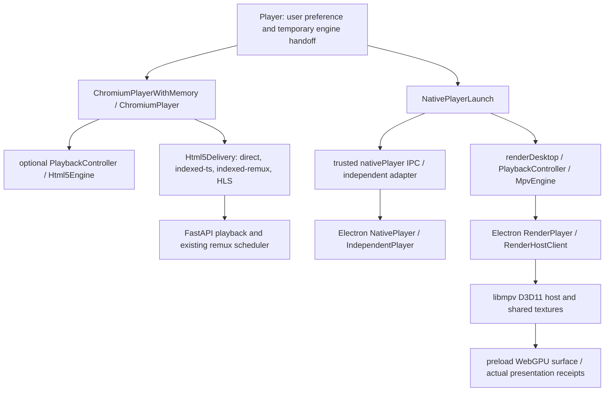
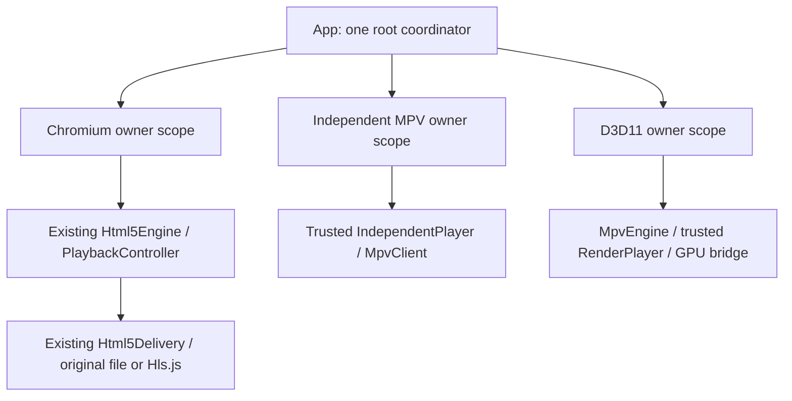

# Architecture optimization baseline

**Current checkpoint, 2026-10-31:** user-authorized local rebuild
3f5396166505433f passes actual EXE/ZIP and physical 125%/175% SDR/HDR
cross-screen acceptance, including 4K PQ/HLG coded charts and the mDCV
screenshot regression. The older build 084031ef4f398db9 remains historical.
Local acceptance is not release approval, hosted CI or colorimetric HDR
certification. See 70's final local-rebuild checkpoint.

2026-10-30, Windows x64; repository jhlxlml/avhub, branch main.

Latest follow-up, 2026-10-31: the minimatch/glob build-tool security blocker is resolved locally with tested consumer upgrades and a hash-guarded installer temp adaptation. Standard npm ci, npm ls, audit (zero vulnerabilities), builds, dependency integration and current-source desktop playback tests pass. Earlier failures below remain historical evidence. Fresh packaging, hosted CI and unavailable physical display verification are not claimed; see 70's latest follow-up.

Subsequent local-candidate checkpoint: following the user's continuation of the proposed local product acceptance, fresh EXE/ZIP and corresponding-source materials were built in isolated build/ directories. Build 084031ef4f398db9 remains version 0.2.17. Actual packaged engine, migration/restart and extracted-ZIP checks pass; all 43 local workflow commands have successful cumulative evidence with failed attempts retained. This is not a hosted-CI, clean-device or physical HDR/mixed-DPI certificate, and nothing was committed, tagged, uploaded or published. Final artifacts: build/architecture-local-acceptance-l1mg4w5l; see 70's local-candidate section.

## Source and protections

HEAD: `9e734f3a7a228e9af1516fdcbeb14174d5ea29ac`, exactly the requested audit baseline. Initial dirty tree: only the untracked user task `AVHub_Codex_Architecture_Optimization_v0.2.17.md`; SHA retained in `build/codex-optimization/user-plan-sha256.txt`. Version stays 0.2.17. No commit/push/tag/Release, archive edits or user-media mutations are authorized in this task. E:\downloads stays read-only.

Node 24.22.1 / npm 11.19.1 locally; hosted workflow pins Node 24.19.0. All original logs and exit ledgers are under build/codex-optimization.

## Stage plans (before implementation)

A: reproduce locked installation/audit; review dependency parents and advisories; fix only compatible vulnerable lock entries; rerun ci/audit/build/engine and backend tests, then source-workflow replay. Hosted CI cannot run uncommitted local changes without the forbidden push; record that gate BLOCKED, never call it green.

B: map actual ownership; introduce a frontend coordinator with immutable identity/snapshot, ordered close/save and generation fencing. Initially attach only one existing, explicit engine-handoff path under a new default-off preference. Keep existing components and main-owned resources; no UI redesign or automatic expansion.

C: make explicit/default/experimental-auto selector decisions observable, preserve Chromium default and main-process authorization. Replace misleading SDR-only experiment naming without adding HDR admission restrictions.

D: inspect existing direct/indexed-ts/remux scheduling and measure actual frame-target seeks on isolated copies/owned samples. Retain current defaults unless a same-source comparison proves an improvement. Missing categories/hardware stay SKIP/BLOCKED; old rawRangePassed=false stays false.

E: audit actual 0.2.17 asset/commit/source/native hashes against its own reports; separate published baseline from optimized working-tree verification. Prepare reproducible instructions and a release-candidate gate only, without building/publishing a new release or claiming untested hardware.

## Actual control/resource flow

Main process owns native process exit, graphics handles, screenshots and read leases. React owns navigation intent, not source paths. MpvEngine seek already waits for a fresh presented target, not command ACK. Player currently switches React branches directly; NativePlayerLaunch separately coalesces stop/save, open cancellation and before-quit. Independent window owns Lua UI and separate progress lifecycle. PlaybackController does not yet coordinate cross-engine handoff. EngineSelector still has historical sdr-trial naming and no implemented auto policy; current persisted playerEngine only accepts chromium/mpv.

## Initial A evidence

npm ci exit 0; npm audit --json exit 1; npm explain fast-uri/undici both exit 0. Vulnerable fast-uri 3.1.8 is below ajv ^3.0.1 via electron-builder. Undici 7.29.1 is optional ^7.24.4 below @electron/get; 6.28.1 is ^6.25.0 below node-gyp. All three are build-tool dependencies, not imported product modules; shipped ASAR explicitly excludes node_modules. This limits the demonstrated product path but does not excuse CI/build supply-chain alerts or cover Node/Electron's own bundled HTTP implementation.

Official advisories: [fast-uri scheme handling](https://github.com/advisories/GHSA-w74x-v6f9-j3xg), [undici EventSource memory bounds](https://github.com/advisories/GHSA-4qv8-2p9j-2685). Complete advisory list is in the raw audit JSON. Compatible resolutions: fast-uri 3.1.9, undici 6.29.1 and 7.30.1. No overrides, --force, security-check changes or Electron/React upgrade. Excluded six unrelated npm-generated optional WASI bundle metadata entries after diff review.

### A implementation and previously hidden regression failures

At the initial A checkpoint only the three package-lock resolutions/integrities changed; package.json was unchanged. `npm audit fix --package-lock-only --ignore-scripts` updated the lock, followed by normal `npm ci`, moderate audit and builds. The lock-only command's script suppression was not applied to installation, audit, Electron or test execution. Electron 44 requires an explicit `node node_modules/electron/install.js` runtime preparation; it completed with exit 0. The later build-tool security follow-up below adds explicit tested overrides and an install-time adaptation.

Read-only GitHub job inspection confirmed runs 41013201534 and 41013196480 both failed at step 9, **Audit locked JavaScript dependencies**; following verification steps were skipped. Their verify jobs are 123923504344 and 123923488738. No remote run/push was requested or performed. Local replay is not a hosted-CI success.

Added an optional owned-build JSON report to `scripts/verify-windows.py`: commands, durations, individual exit codes, completed flag and explicit local/hosted distinction. Failures still stop execution with their original nonzero code. The first complete replay passed audit/build/backend/engine/shared harness gates, then exposed two old UI test defects: its settings keyboard test omitted the existing Appearance tab; preparation policy tested restart semantics but raced an asynchronous resume prompt. Tests now exercise the actual tab order and explicitly select restart in that isolated fixture. Fifteen focused cases and all 194 remaining renderer cases then passed.

The next replay exposed a separate stale preload mock: native-runtime-message omitted onNativeState/onNativeClosed, crashing appearance startup. After restoring the required mock contract, its obsolete developer command/message assertion also failed. Updated the assertion to the current npm prepare command and packaged guidance, retaining disabled-engine, persisted fallback and newly added zero-JS-error assertions. Three focused cases passed. Original failed reports/traces remain in build/codex-optimization; these are renderer contract fixes, not claims of native decoding or changes to the application UI.

## B — implemented scope and ownership

Local A finished before product migration: 43 matched workflow commands, cumulative exit 0. The exact A workflow is preserved with its SHA256 in stage-a-complete.json; B adds coordinator/flag tests to that workflow afterwards.

PlaybackSessionCoordinator is an upper orchestration contract: one current owner, immutable logical session/generation/media/kind and copied source/track snapshots; queued load/switch/seek/close; obsolete intent cancellation; no status=ready until the adapter confirms real readiness. Save/close promises coalesce. A failed in-flight save blocks a concurrent close; a failed close retains the owner for explicit retry. An aborted native acquisition still awaits its real return and release. Recovery is budgeted once and excludes authorization, integrity, damage, persistence, cleanup and unknown failures. Publishing accepted opening intent synchronously also permits cancellation before acquisition starts. No periodic polling was added.

**First live PoC is deliberately bounded:** playbackSessionCoordinatorEnabled defaults false, validates as a boolean and is durable/rollbackable in the existing playback settings. When enabled, renderDesktop wraps its existing MpvEngine/PlaybackController and the awaited native save/close boundary used by D3D11→Chromium return. It does not take native process/texture/lease ownership away from main. NativePlayerLaunch cancels a pending coordinated open before waiting during Back/quit. Closing still waits for actual main-process disposal/recovery; it never reports success merely because renderer waiting was aborted.

The adapter waits for a genuine presented serial, with a bounded 30-second first-presentation wait, not open ACK or a retained image. It preserves play intent across temporary paused seeks and captures validated source fingerprint/track selection/delay; main exposes fingerprint and delay without paths. Errors/snapshot changes remain generation fenced. Nonvisual session phase/generation attributes make this live path observable. The only visible addition is the existing-style opt-in checkbox; no layout/theme/icon redesign.

Chromium/Hls.js, independent MPV/Lua and legacy HWND remain their existing compatible owners. **The three-kind roundtrip is a contract test with fake adapters, not a claim that all three production branches now share a root coordinator.** The receiving Chromium branch in the real PoC still uses its legacy owner. Full root migration/automatic expansion remains off; the actual PoC, default-off rollback and resource release have separate Electron evidence. This follows the document's abstraction-first, one-path-first scope rather than replacing all players.

### C plan before implementation

Replace ambiguous selector output with selected/reason/eligible/recoveryClass while keeping kind compatibility and the default Chromium mapping. Rename the historical SDR trial without changing admitted media or bypassing main's resource checks. Make auto explicitly experimental and conservatively default until a measured policy exists. Table-test missing adapters, authorization, runtime failures and unverified HDR. Remove integrity/build-manifest errors from the legacy automatic-return whitelist; unknown host exit must not be guessed to be a safe decoder initialization failure. Add actionable typed error guidance without authorizing transcoding.

### C implemented

Selector now returns frozen selected/kind/reason/reasonCode/eligible/recoveryClass. Internal html5 remains the persisted chromium default. It only reports candidate eligibility from registered adapters and known facts; unknown runtime/device ability still needs main's actual open validation, avoiding a duplicate expensive native integrity scan. Explicit MPV retains local experiment semantics. New name local-native-experiment replaces the production caller's sdr-trial; the deprecated internal alias stays compatible and is explicitly not a colour restriction. SDR, unverified HDR and unknown colour do not change explicit MPV eligibility.

Auto remains an internal, non-default experimental interface, not a newly persisted preference. With its experiment off it retains HTML5; with it on there is still no admitted measured auto policy, so it retains HTML5 or reports the missing default rather than guessing MPV from an extension. Native integrity, permission, damage, persistence, cleanup and unknown faults require manual handling. A known missing runtime/init/incompatible path can describe a bounded original-quality alternative, never authorize encoding.

A concrete legacy bug was fixed: integrity/build-manifest failures were in mayReturnAfterNativeOpenFailure's automatic whitelist. They now classify as integrity, with no silent return. A generic host exit is unknown, not evidence of recoverable initialization. Classification accepts typed coordinator failures ahead of their text, uses complete trusted messages rather than substrings, and shares the bounded recovery-kind predicate. Typed failures carry operation/cause and actionable recoveryHint; native UI preserves those categories while rendering guidance. Unrecognized backend/device messages stay unknown/manual rather than pretending their cause is verified.

### D plan before implementation

Audit the existing direct/indexed-ts/indexed-remux request ownership, dedup/cancellation, queue, capacity and invalidation code plus regression tests. Extend actual Electron benchmarks with the default-off/on control comparison, reuse the exact owned physical fixture files/source identities, two passes of at least 20 nonmonotonic targets, genuine frame/PTS and compositor barcode proof, first presentation, resource/I/O/process observations and strict teardown. Distinguish initially cold application caches from uncontrolled OS/driver caches. Cover generated codec/bit-depth cases and representative read-only real media; explicitly SKIP missing large/codec categories. Do not alter FFmpeg, prefetch, defaults or quality unless measured evidence warrants it; rawRangePassed=false remains false.

### D audit and actual changes

Existing IndexedRemux serializes short producers, deduplicates cached fragments and validates source fingerprint before cache reuse. RemuxScheduler shares overlapping windows, cancels obsolete targets/waiters, checks fingerprints before serving and publishing, uses bounded speculative windows and LRU eviction, retains active Windows readers and retries cleanup after release. PlaybackManager releases its global lock while remuxing and verifies session identity before returning a reader. Twenty-two actual backend remux/window cases passed. No production FFmpeg arguments, cache quotas, prefetch or quality policy were changed: paired results do not establish a general performance improvement.

Benchmark improvements are test infrastructure: actual runtime-manifest selection (previous m4 harness always described the default directory), strict teardown instead of swallowed Electron close errors, same physical source reuse with SHA/fingerprint checks, initial-cache/repeated-target passes, decoded/GPU/compositor target checks, first presentation, owned-process CPU/memory/I/O/FFmpeg counts and actual Windows GPU utilization counters. Single-sample codec reuse is bound to its recorded sample, not a coincidentally matching numeric directory. Generated fixture metadata changes are fixture construction only, never a playback optimization or user-media change.

**Concrete product bug discovered by the damaged-stream case:** valid MP4 index with undecodable mdat reached EOF with no error, no video size and zero texture imports, yet the legacy native path still said starting/loading after 35 seconds. Original failure: build/render-compatibility-seek-IzoTWA/report.json. Main now bounds first presentation to 30 visible seconds after startup in its existing pump, refreshing the budget while hidden/minimized; no extra global polling or media/colour whitelist. Failure remains actionable and manual with real lease protection. Renderer PoC similarly pauses its first-frame timer on visibility changes. Lack of a first frame is **unknown**, not proof of safe initialization failure, so it no longer silently triggers automatic fallback. Both control modes now pass the actual damaged-stream negative test, close the host and release resources.

### E plan before implementation

Separate source CI from native/packaged acceptance. Audit the actual 0.2.17 artifacts and source ZIP against their own bytes, preserving 0.2.16 only as historical native-cohort evidence. Add strict same-application identity to the three actual packaged harnesses and require it at both input preparation and packaging boundaries: version/build, compiled Electron/frontend payload, actual backend/native/MPV/CLI hashes, source ZIP and report hashes. Reject stale version/build/source reports and source-harness results rather than relabelling them packaged acceptance. Document reproducible candidate preparation using approved pinned materials; do not create a new package, commit, tag, remote run or Release. Current hosted CI, clean-device and physical display certification remain separate gates.

### E implemented: identity-bound evidence, not a new release

Added electron/release-evidence.cjs as the shared boundary for preparation, builder admission and final artifact checks. Schema 2 binds current package/build/timestamp, compiled Electron/frontend payload, current source tree, the frozen backend and its static frontend, native host/libmpv/MPV/CLI manifests and complete resource-tree hashes. Three real desktop harnesses now capture the launched application's own metadata and actual EXE/ASAR bytes. Source-desktop and special local-acceptance subjects cannot certify an ordinary packaged release. A report needs successful cleanup as well as a matching script hash and application; independent, coexistence and render reports must all refer to the same EXE/ASAR. Contract fixtures explicitly contain fake bytes and are never native acceptance.

prepare-desktop-release-inputs.py verifies every indexed source-ZIP member and matches current critical source files before replacing the receipt. stage-m5-source-delivery.py now requires an explicit directory, derives the output version from frozen application metadata, binds the actual backend and includes generated app/build-info.json explicitly: the historical source inventory intentionally excluded that generated file. It refuses to replace existing archives. The ordinary builder rechecks the receipt before packaging and the actual final EXE/ASAR/resources after artifact construction. build-windows.ps1 fails before expensive work on stale inputs, retains audit regardless of dependency-install skipping and freezes the tested build timestamp. All existing runtime hash, source, license and sandbox checks remain.

Identity collection itself is hash-bound alongside each test entry script. Uncompiled frontend public/native source changes also invalidate the source seal, instead of being hidden by a still-current compiled payload. These are concrete stale-evidence cases covered by the release contract; no synthetic byte fixture is treated as a usable executable or as native verification.

Read-only audit of the existing 0.2.17 release: EXE 192,790,598 bytes, ZIP 299,935,074 bytes and source ZIP 247,056,135 bytes match their historical SHA256 values. All 1,168 indexed source members verify; the folder ZIP's actual EXE/ASAR match the historical win-unpacked directory. Its identity is 31ed4eaaec9e5f8f and its lock still has the old fast-uri/undici versions. This is historical integrity evidence, **not current optimized-source acceptance**. Existing M5-BUILD-INPUTS.json still identifies 0.2.16; the new preparation guard rejects it with exit 1 and preserves existing evidence instead of recertifying it.

### Latest P0 recheck: newly reported minimatch blocker

The final 2026-10-31 audit differs from the earlier successful A audit: GHSA-g3hv-75wg-m249 now reports minimatch <11.0.1 and 15 moderate findings in the Electron build-tool chain. Official advisory: https://github.com/advisories/GHSA-g3hv-75wg-m249 (updated October 30). fast-uri 3.1.9 and undici 6.29.1/7.30.1 remain repaired. A non-force lock-only audit fix returns 1 without resolving this new chain. Upstream electron-builder 26.18.0 still uses @electron/asar 3.4.1, @electron/universal 2.0.3 and minimatch ^10.2.5; their transitive consumers also use the old callable minimatch API. A blanket 11.x override is not established compatible, and npm's suggested force command would change electron-builder to an unrelated old major. Neither was applied.

Latest security/release gate is BLOCKED. No further coordinator rollout, engine/default change, packaging or release is authorized by old A PASS. Run the remaining regression commands explicitly as a continuation to diagnose existing changes; their success cannot make the audit green. Recommended resolution is an upstream compatible dependency update/backport, or a separately reviewed and tested build-tool migration if upstream remains blocked. This task does not invent a successful security result or suppress the advisory.

### Pre-toolchain checkpoint (historical)

All 42 non-audit workflow commands completed locally with exit 0; latest focused engine/coordinator/evidence contracts passed 54 cases. Renderer harness total is 627. Current real Electron coordinated native→Chromium original handoff passed with frame/position/pause preserved and complete texture/lease/helper disposal. B remains a default-off one-path PoC, not a completed root migration of all three owners. Historical packaged tests remain historical. The final 60-second concurrency smoke has 1,273 decoded frames, 1 drop, 0 waiting and 21 covers with no pending work; it is not a multi-hour or zero-drop certificate. Full commands, failures, bounded scopes and SKIP/BLOCKED release/hardware gates are in 70 and build/codex-optimization/final-acceptance.json. No new packaging, source commit, tag or remote mutation occurred; version remains 0.2.17 and the user's plan is byte-for-byte unchanged.

## A follow-up — resolved minimatch/glob build dependency chain

Plan: inspect actual consumer APIs, test a candidate dependency graph in owned build directories, require standard npm ci + npm ls + audit and real build-component integration before adoption, then rebuild and run current-source Electron acceptance. Do not force installation, ignore audit, alter runtime quality or manufacture a package result.

The first modern combination (@electron/asar 4.3.1, @electron/universal 3.0.6, minimatch 11.0.3) exposed glob 13's cancellation advisory GHSA-3g3m-2fjr-6pw4. Scope ASAR's glob to 14.0.3; do not indiscriminately replace glob 7's callback API. Official advisory: https://github.com/advisories/GHSA-3g3m-2fjr-6pw4 (patched >=14.0.2).

Real integration then disproved an important compatibility assumption: minimatch 11 returns Matcher objects where glob 7 expects regular expressions with _glob fields. An actual glob 7 recursive match silently returned no files and another pattern threw. That candidate was rejected despite audit returning zero. The old FileList Windows nested-pattern problem was separately reproduced with its original dependency; its supported root-pattern matching remains tested. ASAR's Windows extraction API needs native path separators, including before this upgrade; tests use path.normalize and still verify all bytes.

Final selected graph keeps electron-builder 26.16.1, replaces the old ASAR/universal consumers with the versions above and removes the remaining obsolete temp→rimraf2→glob7 chain. Only electron-winstaller's temp dependency is aliased to real maintained tmp 0.2.7. Its pinned 5.4.0 temp-utils module uses exactly track() and promisified mkdir(prefix). scripts/patch-build-toolchain.cjs adapts those two calls to setGracefulCleanup() and dir({prefix,unsafeCleanup:true}); tmp retains ownership of random directories and recursive exit cleanup. No application media/file-operation behavior changes.

Normal npm ci executes this build-only postinstall. The adaptation requires the expected installer version, an actually resolved owned tmp 0.2.7 alias and the exact upstream SHA256 b5e0c74a54d7ad23fda2bb709533e4976dd359d872188ba223876ea25a2ab541. Patched SHA256 is 847d363706825e186e9f0b1967f15e72d7848502547cf93f99c21fe1c8b1aece. Unknown bytes or versions fail installation without overwriting; already adapted bytes are idempotent. No patch-package dependency or modified registry package version hides the vulnerable code. The old glob/rimraf modules are absent from the actual final graph.

Two local-file override experiments were discarded: npm interpreted paths relative to the nested consumer and retained an invalid link; the install guard rejected the wrong package even when a preceding audit looked green. Final adoption was re-tested from a fresh isolated directory with ordinary install, clean install, full dependency-tree resolution and audit. Tests assert selected dependency paths cannot silently resolve from the parent checkout. Experimental logs and failed versions remain under build/codex-optimization; no application package was generated.

Eight actual dependency integration cases now run in source CI: builder file matching; ASAR crawling/extraction and DLL unpacking; real AsarPackager stream processing, transformed metadata and deterministic fixture bytes; FileList/EJS plus the actual installer helper's process-exit cleanup; absence of the legacy chain; idempotent hash adaptation and unknown-byte refusal; cancellation stopping directory I/O; bounded adversarial minimatch processing. These generate only owned small byte fixtures, not an EXE/portable app. Main npm ci, npm ls, moderate audit, frontend/Electron builds and these cases all returned 0, with zero reported vulnerabilities. The security blocker is resolved locally; hosted CI, fresh package and physical display acceptance remain separate.

One pre-existing smoke harness used --no-sandbox and disabled GPU. Its first result was explicitly excluded from default-security acceptance. The current harness launches with ordinary application arguments and re-tested startup/shutdown successfully; its losing timeout is unreferenced after successful exit. Native flow testing also retains real pointer actions: after a pure-window resize it now hovers the actual exit button before normal clicking. No forced click, synthetic media event, class mutation or hidden-buffering workaround was introduced. Earlier pointer/transition failures remain in the reports, and the current native→Chromium original handoff passes with the current compiled application identity.

## Physical display follow-up baseline (2026-10-31)

User deferred the external-computer test and made two physical monitors available.
Read-only native queries from the actual application report PHL 328E8F SDR,
2560×1440 at 125% / window DPI 120, and portrait LS27D80xU HDR,
2160×3840 at 175% / window DPI 168. The second output reports HDR enabled,
activeColorMode 2, 10 bits/channel and DXGI colorSpace 12; the first reports
SDR, 8 bits/channel and colorSpace 0. No OS HDR, scaling or topology setting
was changed. Electron's colorDepth field differs between launch subjects;
it is retained, not used alone to declare HDR active. The standalone initial
probe is DPI-unaware; use the actual app's native probe for physical bounds.

The tested existing ZIP executable/ASAR remain build 084031ef4f398db9 with
the previously recorded hashes. Physical testing discovered a real HDR PNG
upload failure, so this candidate is no longer fully locally accepted.
Actual MPV capture contains PNG 3 mDCV mastering metadata absent from the
validator's allowlist. The retained raw capture and failed real UI reports
are in build/physical-app-NscRr5 and MKzo7G. No decoder failure, reload or
render fallback caused this screenshot failure.

Source fix: app/screenshots.py accepts standard mDCV (24 bytes) and cLLI
(8 bytes), retaining cICP, requiring single occurrence before IDAT, valid
CRC and accompanying cICP. Existing inflate/pixel/file-size bounds remain.
No image re-encoding, metadata removal, tone mapping or source media writes.
Reference: https://www.w3.org/TR/png/#mDCV-chunk and #cLLI-chunk.
An actual generated chart PNG is retained as the regression fixture with
SHA/provenance in tests/fixtures/native-hdr-pq.md.

New source build is 3f5396166505433f, version still 0.2.17. This is not the
old packaged build or a new release. physical-display-acceptance.mjs uses
actual Electron, real physical monitors and owned profiles/media only;
it records subject identity, native window DPI/HDR flags, imported frame
color attributes, source-open count, frame progression and resource release.
The coordinator remains disabled by default; the second test explicitly
enables it in an isolated profile. No application packaging, external-machine
test, commit, push, tag or Release occurred in this follow-up.

### Extended coded-chart HDR coverage and source delivery

The next continuation adds owned 3840×2160 PQ and HLG charts via
physical-hdr-fixtures.mjs. It stream-copies the existing synthetic SDR10
framecode chart and intentionally changes only that test chart's VUI/container
color declarations. Actual first decoded YUV SHA256 is checked equal to the
original code-value chart; originals and user media remain unchanged. These
are synthetic code-value/transport tests, not color-mastered HDR footage.
Recipes, file hashes and FFprobe output: build/physical-hdr-fixtures-bvRFQC.

The actual application renders these charts on both monitors with 20 distinct
target requests per screen, verified by reading decoded picture barcodes.
Each fixture goes SDR→HDR→SDR, with screenshots/fullscreen/minimize/restore.
Both coordinator states pass. Evidence and conservative timing scope are in
70; no throughput improvement or physical color certification is inferred.

Source-review staging previously omitted tests/fixtures/native-hdr-pq.png,
which would break the new screenshot test after source delivery. The staging
script now includes exactly this owned binary test asset; arbitrary images
and video remain excluded. Five source-delivery tests pass, including actual
copy/hash/inventory checks on a synthetic Git inventory. Release evidence also
correctly rejects the old packaged build against new source; its expected
validator exit 1 is retained rather than bypassed. No package was generated.

## Architecture close-out continuation: 1 → 2 → 3

User authorized test stabilization, a 30–60 minute current-product soak, then
incremental session-coordinator expansion. No further packaging or publication
is requested. Baseline app remains local build 3f5396166505433f; ordinary patch
version stays 0.2.17. Existing working-tree work and the user plan are retained.

Step 1 reproduced the independent-window hover failure with native mouse and
layout telemetry. In native-independent-ysRkYO/hover-trace.json, the injected
position (59,1107) stayed inside the control area for 400 ms. At 450 ms the VO
reported physical position (1682,631), in the picture, while dimensions remained
2085×1173 and scale 1.6. The UI then correctly hid. This is concrete conflicting
input-source evidence, not evidence that stationary control hover is broken.
The protocol-only harness now adds --input-cursor=no to its owned MPV test
process, leaving command-injected pointer input and all production options
unchanged. Official option scope: https://mpv.io/manual/stable/#options-input-cursor.
It verifies actual mouse coordinates and records the 650 ms hover trace. Three
consecutive actual packaged app runs pass. This is not physical OS-pointer
acceptance. Fullscreen harness separately uses fresh elementFromPoint geometry
and ordinary pointer clicks; two consecutive physical-display runs pass.

Step 2 starts with the exact existing packaged EXE/ASAR, normal sandbox/GPU and
isolated owned media. desktop-usage-soak.mjs now records actual subject identity
and tests periodic C screenshots in its production-throttling workload. Planned
20 minutes include 192 generated clips, real decoded cover previews, playback,
scans, thumbnail retries and explicit progress saves; render-app-soak then tests
10 minutes of actual 4K25 SDR10 content and resource convergence. The 960-second
native fixture repeats six-second content. Completion is not inferred from an
unfinished process or another build's report.

Source reading for step 3 found a concrete paused-handoff gap: NativePlayerLaunch
sends initialPaused, but NativePlayer's ordinary open boundary omits that field
and MpvClient.start always unpauses. Address only after the baseline soak. Keep
the coordinator opt-in; main continues owning source leases/native process exit.

### Close-out completed increment

Both baseline soaks completed with exit 0: desktop-usage-avhub-desktop-usage-RiVp6o
(20 minutes, 112 cycles, 19 screenshots, no active drops/waiting/reloads) followed
by render-app-soak-9Ebcg1 (10 minutes 4K25 SDR10, no decoder/VO drops, resource
convergence and actual host/lease/import cleanup). Those results bind build
3f5396166505433f, not the subsequent source build.

Current source build f681953d4f3c5bae adds IndependentSessionAdapter and the small
independentDesktop wrapper under existing default-off playbackSessionCoordinatorEnabled.
Native open validates optional paused once, propagates it through both ordinary
native modes, and MpvClient.start only unpauses when autoplay is requested. The
new trusted independent seek action uses the existing exact-session native queue;
adapter completion requires restart/target agreement rather than command ACK.
Main process ownership, native controls, source track memory and save recovery
remain in place. Existing D3D11 adapter remains selected only under its own mode.
Chromium's existing owner is preserved, not falsely described as migrated.

Actual source Electron tests verify four paused frame-coded handoffs/screenshots
across both native modes with flag on and off, rapid open/Back, independent queue,
save failure/retry/discard/quit, D3D11 fullscreen/zoom/rotation/cleanup. Contracts
24/24 and marked renderer harnesses 15/15 pass; build, Electron compile, audit
(zero vulnerabilities) and diff whitespace checks pass. Detailed paths, failures,
exit codes, fixture limitations and skipped new-source soak/external acceptance
are recorded in 70-architecture-optimization-acceptance.md. No new package or Git
mutation. User plan SHA unchanged. Full cross-mount Chromium coordinator ownership
and a soak of that new source are subsequent increments, not completed claims.

## 2026-11-01 continuation: Chromium owner increment

User authorized continued implementation and a stable push only if warranted.
HEAD is still 9e734f3a7a228e9af1516fdcbeb14174d5ea29ac, main; previous dirty work
and user plan preserved. No release decision is inferred from that authorization.
Source checkpoint is **077cbfa55b67408d**, still 0.2.17 (not a newly prepared tag).

ChromiumSessionAdapter now delegates the actual Html5Engine/controller, existing
Html5Delivery, current track memory and sole durable progress writer. Existing
playbackSessionCoordinatorEnabled remains false by default; its existing settings
row now applies to all three supported paths without changing engine/controller
preferences or redesigning UI. Startup readiness requires a real video frame
callback; seek completion uses frame mediaTime plus original offset and seeked,
including the paused frame-before-seeked ordering. Initial loading seeks retain
the established controller until coordinator readiness, not a second source load.

Explicit save/quit/handoff uses the existing writer through coordinator barriers.
Native handoff awaits Chromium close before starting MPV. During request cleanup,
the adapter freezes the old decoded clock/tracks before React resets shared refs.
The next Chromium attach waits for old session retirement. Failed retirements
remain retryable and block attachment rather than silently discarding ownership.
Cleanup cancels both Html5Engine work and PlaybackController commands, confirms
the backend stop, then clears the old source. Unready owners flush track memory
without inventing a decoded progress snapshot. The failure path now shares this
owner instead of best-effort stop that could lose a failed token.

This remains an incremental integration: actual per-owner adapters use the same
coordinator implementation and explicit handoff barriers. A single root-owned
coordinator across React engine mounts is not claimed. No default promotion,
FFmpeg/quality policy change, native runtime replacement or source-media mutation.
Tests and current release decision are tracked in document 70; build directory
for this continuation is build/architecture-closeout-20261101.

Frozen source acceptance completed: 211 Node/render contracts; 785 backend run
(783 passed, 2 Windows link-privilege skips); 87 marked renderer/decoder tests;
real source Electron flag-on/off handoffs; 1,203s actual library concurrency and
600s actual 4K25 SDR10 coordinator rendering. Library measured 2 active drops in
5,397 frames with no waiting/reloads; native decoder/VO drops 0. Cleanup receipts
confirm host/lease/texture/timer reclamation. Native raw resource range exception
and the passing existing convergence policy are both retained in document 70.
The 1.49s durable-save tail remains visible and measured, not silently suppressed.
Same compiled payload 415b814f84b7d7fd551dff60b482dd4cd3c3ec5c5522f176a0822eff045b5723
binds actual handoff/soak subjects. Publication remains false: cross-mount root
ownership and matching current-source package/source-replay/hosted CI gate are
not complete. No version or remote/Git mutation performed this continuation.

## Root ownership continuation (source checkpoint 7db3a3b77514122b)

The user continued implementation with the preceding conditional authorization
to push a new version if warranted. Source HEAD at entry is unchanged 9e734f3a;
remote main matches, and v0.2.18 does not exist at the remote read check. Existing
user planning document remains untouched and is excluded from source staging.

App now owns one PlaybackSessionCoordinator across keyed Player remounts. Each
actual engine component receives a typed owner scope; factories are captured by
the accepted load instead of changed under an in-flight request. All scopes share
root identity, monotonic generations, the intent/seek queue and prior retirement.
An old scope's close/flush/seek cannot operate on a newer scope. Failed writes or
resource retirement keep their actual owner; an explicitly retried new load can
retire the prior owner before constructing the next factory. Scoped flush/close
coalesce, and root shutdown also awaits pending scoped flushes. Main continues
owning native resources and source leases. Chromium's existing global creation
barrier remains, while application-root retirement replaces the standalone-only
failed-retirement set. No resource deletion or second persistence implementation.

The UI still performs explicit surface/component handoffs; it does not call a
simulated cross-DOM switchEngine or introduce an automatic playback policy. The
root coordinates accepted loads/retirement across those real mounts. Existing
preferences, original-quality permissions and error recovery budget stay intact.
The flag remains default-off; legacy HWND mode remains on its preserved path.

217 Node/render contracts pass, including six new scoped ownership/late-close/
failure/retry contracts. Actual source Electron report session-handoff-app-69JHEy
confirms each round's Chromium -> native -> Chromium root ID is identical with
generations 1 -> 4 -> 7; opening Next.mp4 remounts Player with the same root and
generation 9. A page reload intentionally starts a new App/root between mode
rounds. Independent full flow rZ9hqM and D3D11 full flow 341YSs pass. Component/
decoder harnesses 23/23 pass. No current-source long-soak or current executable
proof is inferred from the earlier 077cbfa55b67408d reports.

Assessment: accumulated security and lifecycle fixes warrant release validation.
Proceed first with reviewed source commit/push to validate hosted CI, keeping
0.2.17 for this ordinary source push. No stable tag/publication until the current
release gates pass; local packaging/upload remains the selected delivery route.
